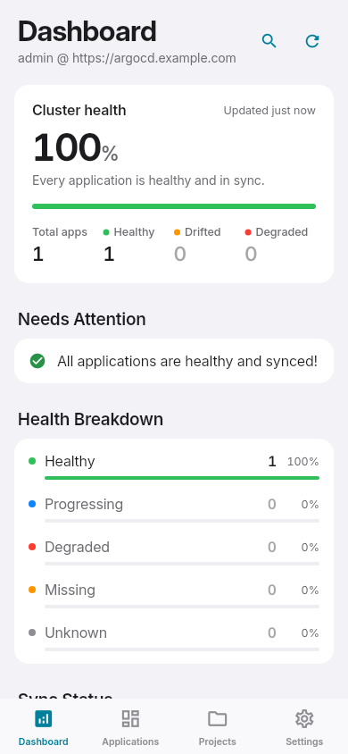
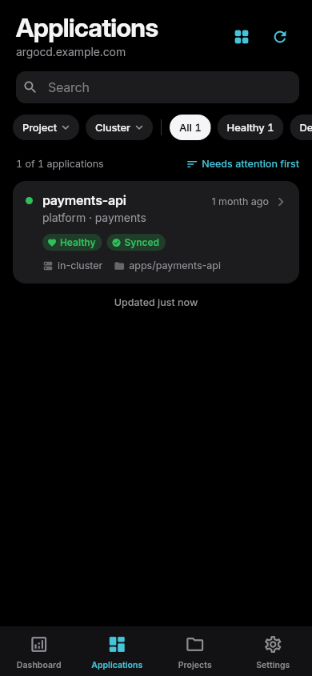
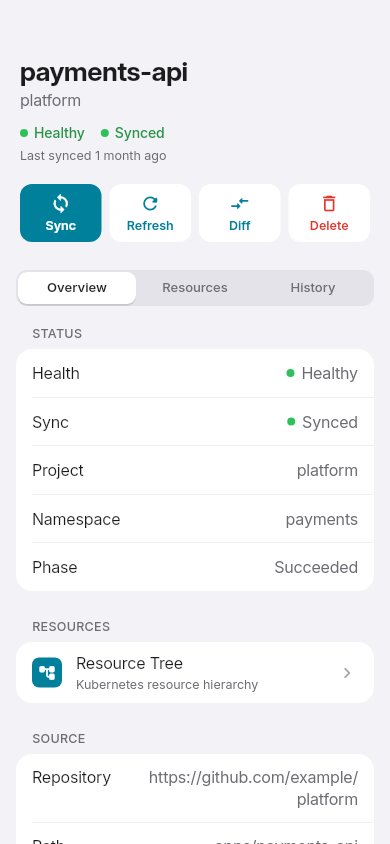

# ArgoCD Flutter

  

Flutter app shell for ArgoCD operators, based on the local development setup
and GitHub Actions shape used in `../happy_flutter`.

## Screenshots

## Setup

1. Install `devenv`: `curl -fsSL https://devenv.sh | bash`
2. Enter the shell: `devenv shell`
3. Fetch packages: `devenv shell -- flutter pub get`
4. Run locally: `devenv shell -- flutter run`

## SSO sign-in

On Android, enter the HTTPS Argo CD server URL and choose **Sign in with SSO**.
The app opens the system browser and uses the same OIDC client and loopback
callback as the Argo CD CLI. For a direct OIDC provider, its CLI client must
allow `http://localhost:8085/auth/callback`; configure `cliClientID` in Argo CD
when the CLI uses a separate client. The provider must support authorization
code with PKCE. Browser sign-in requires network access to both Argo CD and the
identity provider. SSO is currently available on Android; web and other
platforms can still sign in with local Argo CD credentials.

## Quality Checks

- Analyze: `devenv shell -- flutter analyze`
- Test: `devenv shell -- flutter test`
- Build Android debug APK: `devenv shell -- flutter build apk --debug`
- Build web bundle: `devenv shell -- flutter build web --release`

## CI

The repository includes:

- `devenv.nix` aligned with `../happy_flutter`
- GitHub Actions for analysis, tests, APK builds, and web builds
